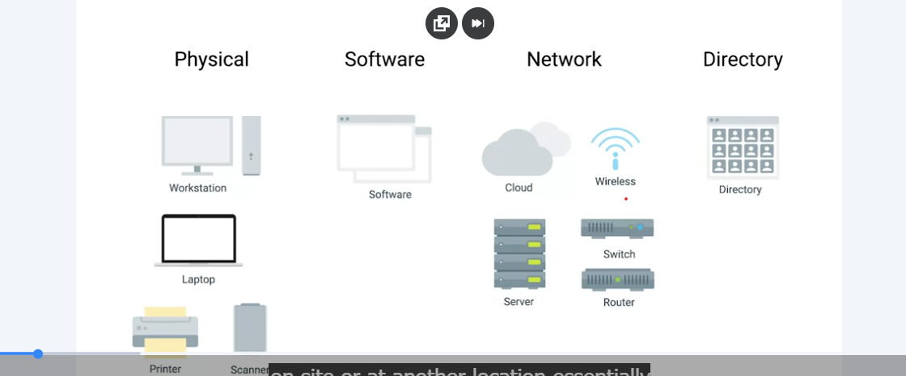

# Types of IT Infrastructure: Physical, Software, Network, and Directory

### IT Infrastructure Services

**Physical Infrastructure:** Physical hardware, such as servers and computers, that a company manages on-site or at another location.

**Infrastructure as a Service (IaaS):** Rents virtual machines and computing resources from a cloud provider instead of managing physical servers.

**IaaS Examples:** Amazon Web Services (AWS EC2), Microsoft Azure, Linode, and Google Compute Engine.

**Network Infrastructure:** Includes computers, IP addresses, subnets, routers, switches, wireless connections, and DNS.

**Networking as a Service (NaaS):** Uses a cloud provider to manage networking services instead of purchasing and maintaining networking hardware.

**Software:** Applications that employees use to perform work, such as word processors, email clients, and spreadsheets.

**Software as a Service (SaaS):** Provides software over the internet, usually through a web browser, without requiring users to install and maintain it on every computer.

**SaaS Examples:** Microsoft Office 365 and Google Workspace.

**Platform as a Service (PaaS):** Provides a platform for developers to build, run, and deploy applications without managing all the underlying infrastructure.

**PaaS Examples:** Heroku, Microsoft Azure, and Google App Engine.

**Directory Service:** Centrally manages user accounts, computers, and access permissions within an organization.

**Directory Service Examples:** Windows Active Directory and OpenLDAP.

**Directory as a Service (DaaS):** Provides directory services through the cloud.

### Cloud Services: Advantages and Disadvantages

**Advantages:** Reduces the need to purchase and maintain physical hardware.

**Disadvantages:** Creates recurring costs and dependence on the cloud provider.

**Important:** Understand how a service works and how to maintain it before relying on a cloud provider.

### Server Operating systems
Regular operating systems that are optimized for server functionality 

### Remote Access

**Remote Access:** Connecting to and controlling a computer from another location.

**Uses of Remote Access:** Fix computer problems, transfer files, and work from home.

### Remote Access Tools

**SSH (Secure Shell):** Securely connects to another computer to run commands and transfer files. Commonly used with Linux servers.

**RMM (Remote Monitoring and Management):** Allows IT staff to monitor, maintain, and update many computers remotely.

**RDP (Remote Desktop Protocol):** Allows you to see and control another computer's desktop remotely. Uses port 3389.

**VPN (Virtual Private Network):** Creates an encrypted connection to a private network over the internet, allowing remote users to access company resources securely.

### Third-Party Tools

**Video Conferencing Apps:** Tools like Zoom, Google Meet, and Microsoft Teams allow people to meet online and share screens.

**Cloud File Sharing:** Services like Google Drive, OneDrive, and Dropbox let users store and share files online.

**FTP (File Transfer Protocol):** Used to transfer files between computers. Secure versions can use SSH or HTTPS.

### Security Risks

**RDP Risks:** Attackers may exploit weak passwords or stolen login information to access computers.

**Remote Access Security:** Remote connections need strong passwords, encryption, and security updates to help prevent attacks.

**Cloud Storage Risks:** Cloud file sharing may create privacy or security problems if files are not properly protected.
