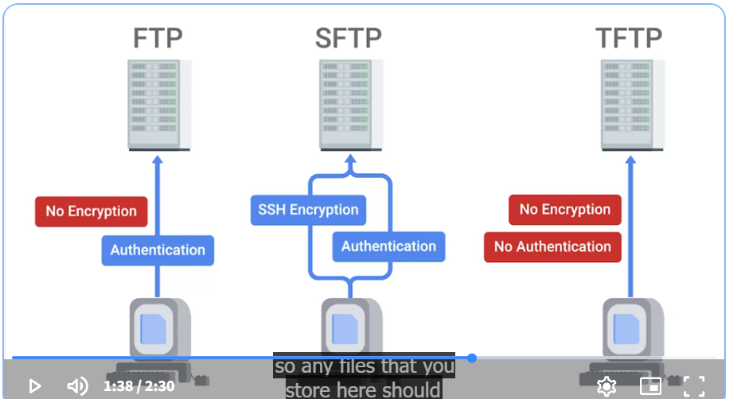

# FTP, SFTP, and TFTP

**FTP (File Transfer Protocol):** Transfers files between computers over a network. It does not encrypt data by default.

- The FTP service works much like the SSH service.
- Clients that want to access an FTP server have to install an FTP client.

- **Pros:** Easy to use and supports transferring large files.
- **Cons:** Data, including passwords, is sent without encryption, making it less secure.

**SFTP (SSH File Transfer Protocol):** Transfers files securely using SSH encryption.

- **Pros:** Encrypts files and login information, making transfers more secure.
- **Cons:** Requires an SSH server and can take more setup than FTP.

**TFTP (Trivial File Transfer Protocol):** A simple file transfer protocol that uses UDP and has very few features. Often used to transfer configuration files or boot files to network devices.

- **Pros:** Simple, lightweight, and requires little setup.
- **Cons:** No built-in encryption or authentication, making it insecure for sensitive files.

### Quick Comparison

| Protocol | Security | Common Use |
|---|---|---|
| FTP | No encryption by default | General file transfers |
| SFTP | Encrypted using SSH | Secure file transfers |
| TFTP | No built-in encryption or authentication | Network device configuration and boot files |

**Easy way to remember:**
- **FTP:** Transfers files.
- **SFTP:** Securely transfers files.
- **TFTP:** Transfers files using a simple, basic protocol.

### Network time protocol (NTP)
Its used to keep the clock synchronized on machines connected to a network 

### Intranet
An internal network inside a company; accessible if you're on a company's network 

### Proxy Server
Acts as an intermediary between a company's network and the internet. Basically its a server that acts as a middleman between your computer and the internet.

**Why it's used:** To filter internet traffic, improve security, control website access, and sometimes make websites load faster using cached data.

### Domain name System (DNS)
Map human-understandable names to IP addresses

# DNS and DHCP

**DNS (Domain Name System):** Turns website names into IP addresses. Example: Finds the IP address for `google.com`. Think of it as a phone book.

**DHCP (Dynamic Host Configuration Protocol):** Automatically gives devices IP addresses and other network settings when they join a network. Example: Gives your laptop an IP address when it connects to Wi-Fi.

**How DNS and DHCP work together:**
1. **DHCP:** Gives your laptop an IP address when it connects to Wi-Fi.
2. **DNS:** Finds the IP address for a website when you type its name.
3. **Your laptop:** Uses that IP address to connect to the website.

**Main difference:** DHCP gives your device an IP address, while DNS finds the IP address associated with a name.

# Question exercise  
A small, growing startup (50 employees) is setting up its IT infrastructure. They need to choose between physical servers, on-premise virtual machines, or cloud-based VMs (IaaS). They also need to set up internal network services.

### 1. Server Choice

**Physical servers:** The company owns and maintains the hardware. An advantage is having direct control over the equipment. A disadvantage is the high upfront cost and the need to maintain it.

**On-premise virtual machines (VMs):** Multiple virtual servers run on the company's physical hardware. An advantage is that they can run multiple servers on one machine, saving space and money. A disadvantage is that the company must maintain the physical hardware.

**Cloud-based VMs (IaaS):** The company rents virtual servers from a cloud provider. An advantage is that it can easily increase or decrease resources as the company grows. A disadvantage is the ongoing cost and reliance on an internet connection and cloud provider.

### 2. Networking

**DHCP (Dynamic Host Configuration Protocol):** Automatically assigns IP addresses and other network settings to employee workstations when they connect to the network.

**DNS (Domain Name System):** Translates domain names into IP addresses so employees can access websites and internal services using names instead of remembering IP addresses.

**Static IP Address:** An IP address that stays the same. Companies might use static IPs for servers and network printers so they are easier to locate.

**Dynamic IP Address:** An IP address assigned automatically by DHCP. Companies might use dynamic IPs for employee workstations because they are easier to manage.

### 3. Troubleshooting

One important step is to document the network setup, including IP addresses, device names, and network diagrams. This makes it easier for IT staff to identify and fix problems when they occur.