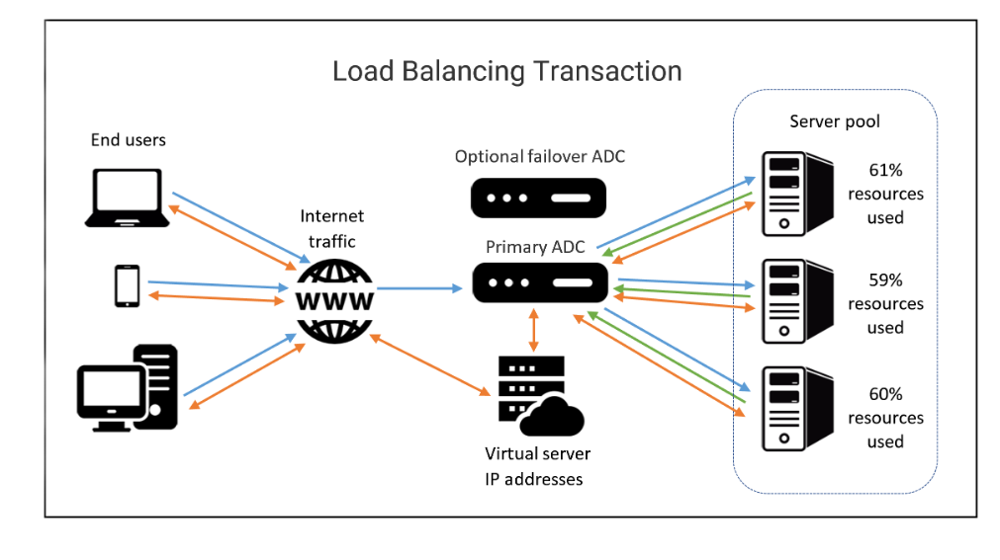

Platform services provide a platform for developers to completely build and deploy software applications, without having a deal with OS maintenance, server hardware. networking or other services that are needed to use the platform tools 

**Web Server:** A computer or software that stores website files and sends them to browsers.

**HTTP:** A set of rules that allows web browsers and web servers to communicate.

**HTTPS:** A secure version of HTTP that encrypts information sent between a browser and a web server.

## Load Balancers

**Load Balancer:** Distributes network traffic across multiple servers so one server doesn't become overloaded.

**Why use load balancers?**
- **Performance:** Spreads traffic across servers to improve performance.
- **High Availability:** Redirects traffic if a server fails.
- **Scalability:** Allows servers to be added or removed as needed.
- **Reliability:** Helps keep services running when a server goes down.

### Load Balancing Terms

**Client:** A computer or program that requests information from a server.

**Host/Node:** A physical or virtual server that receives network traffic.

**Member:** A host/node identified by its IP address and the TCP port used by an application.

**Pool/Cluster/Farm:** A group of servers providing similar services.

**Application Delivery Controller (ADC):** Hardware or software that manages and directs network traffic between clients and servers.

**Path-Based Routing:** Directs traffic based on the URL path.

**Listener:** Monitors incoming traffic and forwards requests to the appropriate servers.

**Front End:** The part that receives client requests and connects them to the back-end servers.

**Back End:** The servers that handle client requests.

**Containerization:** Runs applications in isolated environments, making them easier to deploy and scale.

**Availability Zone (AZ):** A separate data center location within a cloud region designed to help keep services available.

**Elastic Load Balancer (ELB):** Distributes traffic across servers and can use multiple Availability Zones.

**SSL/TLS:** Protocols that encrypt data sent over a network.

# Example of ADC process for load balancing 

### How an ADC Load Balancer Works

1. **Blue – Client Request:** The client sends a connection and information request to the ADC.
2. **Blue – ADC Selects a Server:** The ADC accepts the request and chooses the best server. It changes the destination IP address (and possibly TCP port) to send the request to that server.
3. **Green – Server Response:** The selected server accepts the connection and sends its response back through the ADC.
4. **Orange – ADC Forwards Response:** The ADC changes the source IP address (and possibly TCP port) to the virtual server's address before sending the response to the client.

**Remember:** The ADC directs client requests to the best server and sends the responses back to the client.

### How Load Balancing Works

1. The client sends a request to the load balancer.
2. The load balancer chooses the best server for the request.
3. The selected server processes the request and sends a response back through the load balancer.
4. The load balancer forwards the response to the client.

### Types of Load Balancers

**Application Load Balancer:** Works at the application layer (Layer 7) and handles HTTP/HTTPS traffic.

**Network Load Balancer:** Works at the transport layer (Layer 4) and handles TCP/UDP traffic. Useful for large amounts of traffic.

**Classic Load Balancer:** Handles traffic at either the application or transport layer using fixed ports.

**Gateway Load Balancer:** Works at the network layer (Layer 3) and directs IP traffic through network appliances.

### Cloud Load Balancers

- **Google Cloud:** Offers different types of load balancing, autoscaling, and protection against DDoS attacks.
- **AWS:** Offers Application, Network, and Gateway Load Balancers.
- **Microsoft Azure:** Offers public load balancers for internet traffic and internal load balancers for private networks.

### Physical Load Balancing

**Active-Active Cluster:** Two or more servers handle network traffic at the same time.

**Remember:** A load balancer distributes traffic across servers to improve performance and keep services running if a server fails.

### Databases
Allow us to store, query, filter, and manage large amounts of data

### Apache2
Web server software that delivers websites to users through their web browsers.

**Example:** When someone visits a website, Apache2 sends the website's files to their browser so they can see the page.

# Troubleshooting platform services
HTTP status codes are codes or numbers that indicate some sort of error or info messages that occurred when trying to access a web resource 

- Knowing these codes are helpful when trying to figure out a problem with a website some examples of these codes are...

### 404 Not Found
A 404 error indicates that the URL you entered doesn't point to anything 

- HTTP status codes that start with **4xx** indicate an issue on the **client-side**

- The other common HTTP status code you might see start with **5xx**

- These errors indicate an issue on the **server-side**

- HTTP status codes tell us more than just errors 

- They can also tell us when our request is **successful**, which is denoted by the codes that begin with 2xx

- Tools that are built into the browsers to help diagnose issues with the browsers are called developer tools 