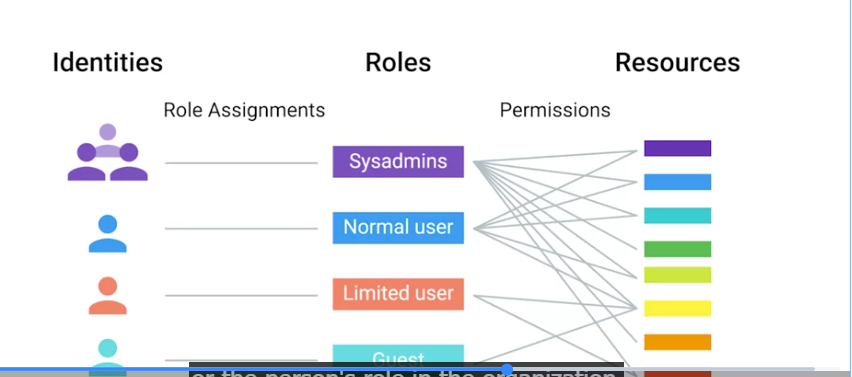
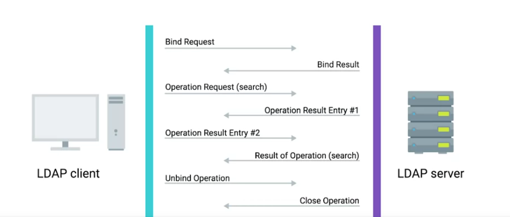
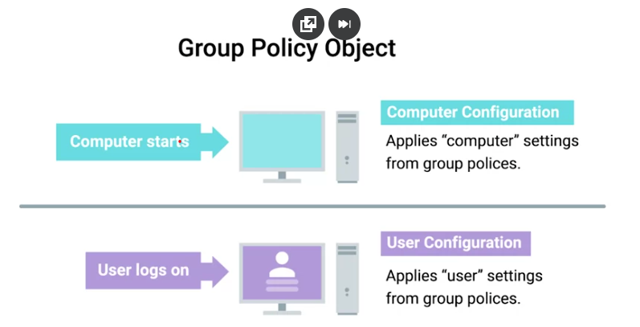

### Directory Server
Contains a lookup service that provides mapping between network resources and their network addresses

### Replication
The stored directory data can be copied and distributed across a number of physically distributed servers, but still appear as one unified datastore for querying and administrating 

### Directory services
Useful for organizing data and making it searchable for an organization

### Centralized management 
A central service that provides instructions to all of the different parts of my It infrastructure 

if you or another person change roles in the company, then all you have to do is change the groups that you are a part of, not the rights that you have to directly access resources 

We call this role-based access control or RBAC

### Lightweight Directory Access Protocol (LDAP)
Used to access information in directory services like over a network

# Two of the most popular directory services that use LDAP are...
- Active directory 
- OpenLDAP

# LDAP (Lightweight Directory Access Protocol)

**LDAP:** A protocol used to look up information in a directory.

**Examples:**
- **Login:** Looks up user accounts.
- **User management:** Finds usernames and email addresses.
- **Access control:** Looks up group memberships.
- **Centralized accounts:** Lets multiple systems access directory information.
- **Employee directory:** Finds employee names and contact information.

**Active Directory:** Microsoft's directory service that supports LDAP.

### Bind operation 
Authenticates clients to the directory server 

# There are three common ways to authenticate 
- Anonymous
- Simple
- SASL (SImple Authentication & Security Layer)

### Kerberous
A network authentication protocol that's used to authenticate user identity, secure the transfer of user credentials, and more 

### Active directory (AD)
The native directory service for Microsoft Windows 

### Group Policy Objects (GPO)
Are ways to manage the configuration of Windows machines 

### Active Directory Administrative Center (ADAC)
A tool that we'll use for lots of the everyday tasks 

### Organization Unit (OU)
A folder or directory for organizing objects within a centralized management system

A forest contains one or more domains. Accounts can share resources between domains in the same forest  

### Security account manager (SAM)
A database in Windows that stores usernames and passwords

### Security group
Can contain user accounts, computer accounts or other security groups 

### Distribution group
Only designed to group accounts and contacts for email communication 

You can't use distribution groups for assigning permissions to resources 

### Domain local 
This is used to assign permissions to a resource 

### Global 
This is used to group accounts into a role

### Universal
This is used to group global roles forest 

If there's more than one person who can **authenticate** using the same username and password, then **auditing** becomes difficult or even impossible. 

### Group policy object (GPO)
A set of policies and preferences that can be applied to a group of objects in the directory 

When you **link** a GPO, all of the computers or users under that domain, site, or OU will have that policy applied 

A Group Policy Object can contain **computer configuration, user configuration**, or both.

### Policies 
Settings that are reapplied every few minutes, and aren't meant to be changed even by the local admins

### Group policy preferences 
Setting that, in many cases are meant to be a template for settings 

### Windows registry 
A hierarchial database of settings that Windows, and many Windows applications used for storing configuration data

When a computer is processing the group policy objects that apply to it, all of these policies will be applied in **precedence** rules

One of the most common issues you might encounter is when a user isn't able to login to their computer, or isn't able to authenticate to the Active Directory domain

A common issue that you might have to troubleshoot is when a GPO-defined policy or preference **fails to apply to a computer**

# Windows Server Group Policies

### Important Terms

- **GPO (Group Policy Object):** A collection of settings that controls computers and users in an organization.
- **GPMC (Group Policy Management Console):** A tool used to create, edit, manage, and apply GPOs.
- **Active Directory (AD):** Organizes users, computers, and groups in a network.

### Active Directory Containers

- **Sites:** Groups computers and networks based on physical locations.
- **Domains:** Groups users, computers, and other objects in a network.
- **OUs (Organizational Units):** Groups users and computers by department, such as IT, sales, or accounting.

### GPO Processing Order

Windows applies Group Policies in this order:

1. Local GPO
2. Site GPO
3. Domain GPO
4. OU GPO

**Note:** Group Policies normally refresh every 90 minutes.

### Other Important Terms

- **RSoP (Resultant Set of Policies):** Shows which Group Policy settings are applied to a user or computer.
- **WMI (Windows Management Instrumentation):** Provides information about Windows systems and helps administrators manage computers.
- **MI (Management Infrastructure):** The newer version of WMI. It is backwards-compatible with WMI.

---

# Group Policy Troubleshooting Tools

### Command-Line Tools

- **gpresult:** Shows which Group Policies are applied to a user or computer.
  - `/r` - Shows a summary of applied GPOs.
  - `/z` - Shows detailed policy information.
  - `/s` - Checks a remote computer.
  - `/u` - Displays information for a specific user.

- **gpedit:** Opens the Group Policy Editor. Used to change Windows settings and policies.

- **gpupdate:** Refreshes Group Policies.
  - `/force` - Forces all policies to update.
  - `/logoff` - Logs the user off if needed.
  - `/boot` - Restarts the computer if needed.

### Event Viewer and Windows Logs

**Event Viewer:** A Windows tool used to view system events, errors, and problems.

Main Windows Logs:

- **System:** Records Windows, hardware, driver, and service problems.
- **Application:** Records application errors and events.
- **Security:** Records security events, such as login activity.
- **Setup:** Records installation events and errors.

# Troubleshooting Group Policy Issues

## Scenario 1: Group Policy Settings Not Being Applied

If GPO changes aren't showing up for users or computers, check the following:

1. **GPO Scope:** Make sure the GPO is linked to the correct OU containing the target users or computers.
2. **Security Filtering:** Make sure the correct users and computers are included in the security filter.
3. **Read and Apply Permissions:** Check that users and computers have permission to read and apply the GPO.
4. **Group Policy Delegation:** Check who has permission to edit, delete, or manage the GPO.
5. **GPO Status:** Make sure the GPO and its User/Computer configurations are enabled.
6. **LSDOU Order:** Policies apply in this order:
   - Local
   - Site
   - Domain
   - OU

   Later policies can override earlier settings. OU policies are applied last.
7. **Link Enabled:** Make sure the GPO link to the OU is enabled.
8. **Enforced GPO:** An enforced GPO can override other policies and cannot be blocked by inheritance.
9. **Block Inheritance:** Prevents an OU from receiving inherited GPOs unless they are enforced.
10. **Loopback Processing:** Changes how user policies are applied based on the computer's OU.
11. **MI/WMI Filters:** Check filters to make sure the target computers meet the requirements for the GPO.
12. **Check GPO Settings:** Make sure the settings actually do what you expect them to do.

## Scenario 2: GPO Settings Are Incorrect

If a GPO has incorrect settings:

1. Open Group Policy Management.
2. Find and right-click the incorrect GPO.
3. Select **Edit**.
4. Fix the incorrect settings.

## Scenario 3: User Can't Authenticate Into Active Directory

- **Check Active Directory Infrastructure:** Make sure the user or computer can connect to a Domain Controller.
- Domain Controller or AD replication problems can prevent users from authenticating and Group Policies from working correctly.

---

## Key Takeaways

When troubleshooting Group Policy problems, remember to check:

- GPO Scope and Security Filtering.
- Read and Apply permissions.
- GPO Status and Delegation.
- LSDOU processing order.
- Enabled GPO links.
- Enforced GPOs and Block Inheritance.
- Loopback Processing.
- MI/WMI Filters.
- Active Directory and Domain Controller connections.

### Remote wipe
A factory reset that you can trigger from your central MDM, rather than having to do it in person on the device

### Idapadd
Takes the input of an LDIF file and adds the context of the files

### Idapmodify
Modifies an existing object 

### Idapdelete
Will remove the object that the LDIF file refers to

### Idapsearch
Will search for entries in your directory database 
