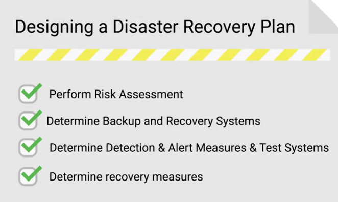

### Data recovery
The process of trying to restore data after unexpected event that results in data loss or corruption

When an unexpected event occurs, your main objective is to **resume normal operations** as soon as possible, while minimizing the disruption to business functions 

The best way to be prepared for a data-loss event is to have a well-thought-out **disaster plan and procedure** in place.

Disaster plans should involve **making regular backups** of any and all critical data that's necessary for your ongoing business processes

A **post-mortem** is a way for you to document any problems you discovered along the way, and mos importantly, the ways you fixed them so you can make sure they don't happen again 

Backing up isn't free the more you back up the more space it takes so make sure to only back up what is necessary

### Examples of things to backup
- E-mail databases
- Sales databases
- Financial spreadsheets
- Server configurations
- Databases 

# local storage of backups
### pros
- Data is physically nearby
- Low bandwidth needs
### cons
- Data loss due to damage at the location

# off-site storage
### pros
- Data is safer in multiple locations

### cons
- Needs security and encryption 
- needs large amount of bandwidth

### rsync
A file transfer utility that's designed to efficiently transfer and synchronize files between locations or computers

Always test backups because failed backups can make a company lose a lot of needed data

### Restoration procedures
Should be documented and accessible so that anyone with the right access can restore operations when needed

# Ways to perform regular backups
- Full backup
- Differential backup: just backing up things that changed
- Regular incremental backups 

It's a good practice to perform infrequent full backups, while also doing more frequent differential backups 

While a differential backup backs up files that have been changed or created since the last full backup, an incremental backup is when only data that's changed in files since the last incremental backup is backed up

### Redundant Array of Independent Disks (RAID)
A method of taking multiple physical disks and combining them into one large virtual disk 

# Methods for user backups
- Dropbox
- Apple iCloud 
- Google Drive 

### Disaster recover plan
A collection of documented procedures and plans on how to react and handle an emergency or disaster scenario, from the operational perspective 

### Preventive measures
Any procedures or systems in place that will proactively minimize the impact of a disaster 

### Detection measures
Meant to alert you and your team that a disaster has occurred that can impact operations 

### Corrective or recovery measures
Those enacted after a disaster has occurred

### Risk assessment 
Allows you to prioritize certain aspects of the organization that are more at risk if there's an unforeseen event

