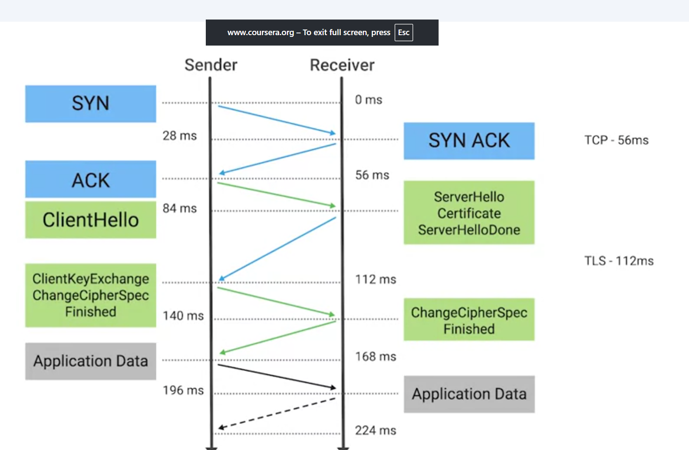
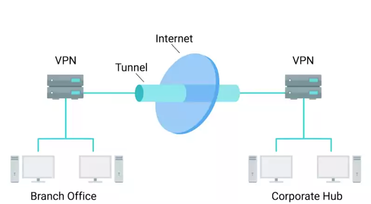
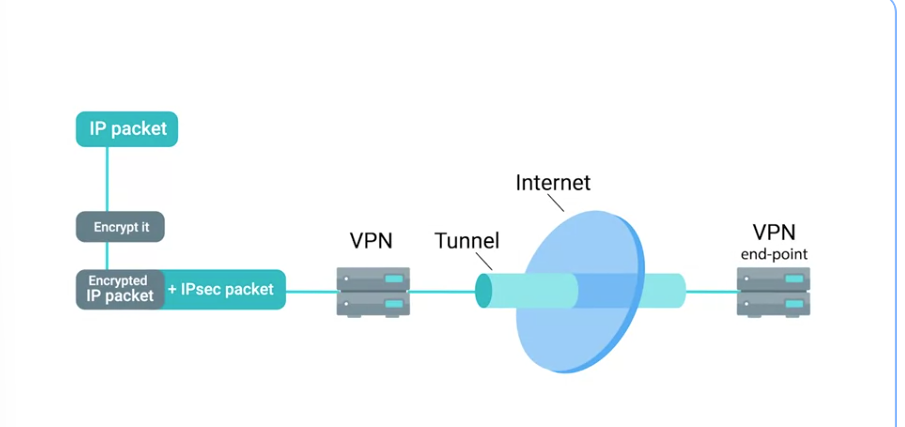

PKI is a system that defines the creation, storage, and distribution of digital certificates 

A digital certificate is a file that proves that an entity owns a certain public key 

# A certificate contains..
- info on public key
- registered owner
- digital signature 

There's also an RA, or registration authority that's responsible for verifying the identities of any entities requesting certificates to be signed and stored with the CA, CA stands for Certificate Authority.
A Certificate Authority is a trusted organization or service that issues, signs, and manages digital certificates.

A central repository is needed to securely store and index keys, and a certificate management system of some sort makes managing access to stored certificates and issuance of certificates easier 

An SSL/TLS client certificate, are certificates that **are bound to clients** and are used to **authenticate** the client to the server. allowing access control to an SSL/TLS service 

There are also code certificates ​which are used for signing executable programs. ​This allows users to these signed applications to verify the signatures and ensure that the application was not tampered with 

A certificate that has no authority as a CA is referred to an end-entity or leaf certificate 

The X.509 standard is what defines the format of digital certificates 

### Version
What version of the X.509 standard the certificate adheres to 

### Serial number
a unique identifier for the certificate assigned by the CA which allows the CA to manage and identify individual certificates 

### Certificate signature algorithm 
This field indicates what public key algorithm is used for the public key and what hashing algorithm is used to sigh the certificate 

### Issuer name 
This field contains information about authority that signed the certificate 

### Validity
This contains two subfields - "Not Before" and "Not After" - which define the dates when the certificate is valid for 

### Subject 
This field contains identifying information about the entity the certificate was issued to 

### Subject public key info
These two subfields define the algorithm of the public key, along with the public key itself 

### Certificate signature algorithm 
same as the subject public key info field; these two fields must match 

### Certificate signature value
The digital signature data itself 

### HTTPS
The secure version of HTTP, the HyperText Transport Protocol

# TLS grants us three things...
1. A secure communication line, which means data being transmitted is protected from potential eaves droppers 
2. The ability to authenticate both parties communicating, though typically only the server is authenticated by the client 
3. The integrity of communications, meaning there are checks to ensure that messages aren't lost or altered in transit 

# TLS handshake 

The session key is the shared symmetric encryption key used in TLS sessions to encrypt data being sent back and forth 

### Forward secrecy 
This is a property of a cryptographic system so that even in the event that the private key is compromised, the session keys are still safe 

### Secure shell (SSH)
A secure network protocol that uses encryption to allow access to a network service over unsecured networks 

### Pretty good privacy (PGP)
An encryption application that allows authenticate of data, along with privacy from third parties, relying upon asymmetric encryption to achieve this 

### Virtual Private network (VPN)
A mechanism that allows you to remotely connect to a host or network to an internal private network, passing the date over a public channel, like the internet 

# IP packet example

When **transport mode** is used, only the payload of the IP packet is encrypted, leaving the IP headers untouched 

In **tunnel mode**, the entire IP packet, header payload and all, is encrypted and encapsulated inside a new IP packet with new headers

The **tunnel** is provided by L2TP which permits the passing of unmodified packets from one network to another 

The **secure channel**, on other hand, is provided by IPsec, which provides confidentiality, integrity, and authentication of data being passed 

OpenVPN can operate over either TCP or UDP typically over port 1194

The combination of L2TP and IPsec is referred to as L2TP/IPsec and was officially standardized in 
IETF RFC 3193.

An example of this is 
OpenVPN, which uses the OpenSSL library to handle key exchange and encryption of data along with control channels. 

### TPM (Trusted Platform Module)
A security chip in a computer that securely stores encryption keys and helps protect the system from unauthorized access.

# TPMS offer...
- Secure generation of keys 
- Random number generation
- Remote attestation 
- Data binding and sealing 

A TPM has unique secret RSA key burned into the hardware at the time manufacture, which allows a TPM to perform things like hardware authentication 

This can detect unauthorized hardware changes to a system 

Remote attestation is the idea of a system authenticating its software and hardware configuration to a remote system 

this enables the remote system to determine the integrity of the remote system 

Another use of the secret hardware backed encryption key is data binding and ​sealing, It involves using the secret key to derive a unique key that's used for encryption of data 

Data sealing is similar to binding since data is encrypted using the hardware backed encryption key.

But in order for the data to be decrypted, the TPM must be in a specified state 

### Secure element 
It's a tamper resistant chip often embedded in the microprocessor or integrated into the mainboard of a mobile device 

It supplies secure storage of cryptographic keys and provides a secure environment for applications 

### Trusted execution environment (TEE)
It provides a full-blown isolated execution environment that runs alongside the main OS

This provides isolation of the applications from the main OS and other applications installed there 

It also isolates secure processes from each other when running in the TEE