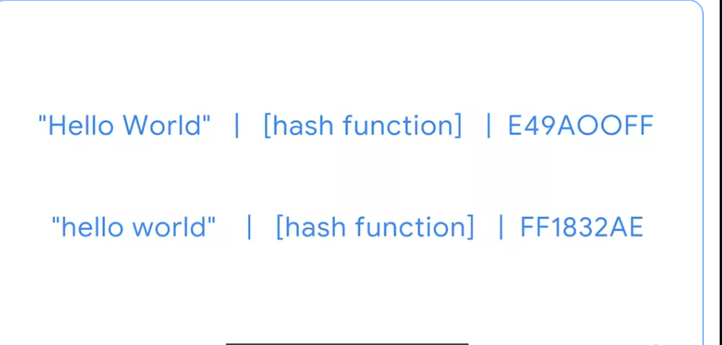
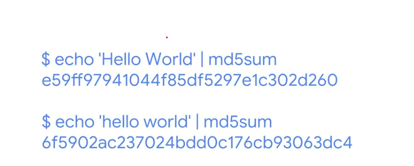

### Hashing (or a hash function)
A type of function or operation that takes in an arbitrary data input and maps it to an output of fixed size, called a hash or digest 

You feed in any amount of data into a hash function and the resulting output will always be the same size, but the output should be **unique to the input**, such that two different inputs should never yield the same output

Hashing can also be used to identify duplicate data sets in databases or archives to speed up searching of tables or to remove duplicate data to save space 

Cryptographic hashing is distinctly different from encryption because cryptographic hash functions should be one directional 

The ideal Cryptographic hash function should be **deterministic**, meaning that the same input value should always return the same hash value

### Hash collisions
Two different inputs mapping to the same output 

# Examples of hash functions
### Example one

### Example two

SHA1 is part of the Secure Hash Algorithm suite of functions, designed by the NSA, published in 1995

A MIC is essentially a hash digest of the message in question

You can think of it as a check sum for the message, ensuring that the contents of the message weren't modified in transit 

Most passwords in authentication softwares are stored as hash functions because this is more secure then saving them in plain text.

A Successful brute force attack, against even the most secure system imaginable is a function of attacker time and resources 

If any attacker has unlimited time and resources any system can be hacked using brute force tactics 

### Password salt
Additional randomized data that's added into the hashing function to generate a hash that's unique to the password and salt combination 