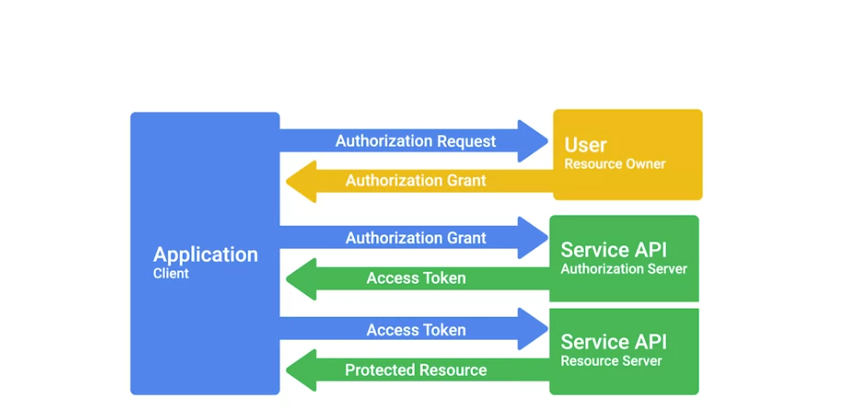

### Authorization
Pertains to describing what the user account has access to, or doesn't have access to

### OAuth
An open standard that allows users to grant third party websites and applications access to their information without sharing account credentials 

OAuth permissions can ve used in phishing-style attacks to gain access to accounts, without requiring credentials to be compromised 

### Access control list (ACL)
A way of defining permissions or authorizations for objects 