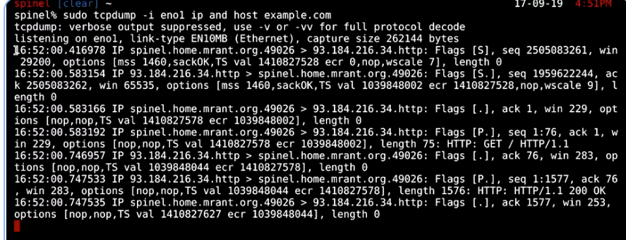
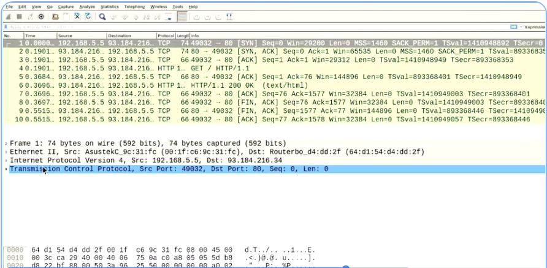

### Packet sniffing (packet capture)
The process of intercepting network packets in their entirety for analysis

### Promiscuous mode
A type of computer networking operational mode in which all network data packets can be accessed and viewed by all network adapters operating in this mode 

### Port mirroring 
Allows the switch to take all packets from a specified port, port range, or entire VLAN and mirror the packets to a specified switch port 

### Monitor mode
Allows us to scan across channels to see all wireless traffic being sent by APs and clients

### Tcpdump
A super popular, lightweight, command-line based utility that you can use to capture and analyze packets 

- **Wireshark:** A network protocol analyzer used to capture and inspect network traffic.
- **Wireshark vs. tcpdump:** Wireshark has a graphical interface (GUI), making packets easier to read and analyze. tcpdump uses a command-line interface (CLI).
- **Advantage:** Wireshark makes troubleshooting and analyzing network traffic easier.

### Intrusion detection and prevention systems (IDS/IPS)
IDS or IPS systems operate by monitoring network traffic and analyzing it 

What exactly do IDS and IPS systems do? ​They look for matching behavior or ​characteristics that would indicate malicious traffic. ​The difference between an IDS and ​an IPS system is that IDS is only a detection system. ​It won't take action to block or ​prevent an attack when one is detected, ​it will only log and alert. ​ ​But an IPS system can adjust firewall rules on ​the fly to block or drop ​the malicious traffic when it's detected. ​IPS and IDS systems can ​either be host-based or network-based. 

### Network intrusion detection system (NIDS)
The detection system would be deployed somewhere on a network where it can monitor traffic for a network segment or subnet 

- **NIDS (Network Intrusion Detection System):** Monitors network traffic for suspicious activity and alerts administrators.
- **NIPS (Network Intrusion Prevention System):** Monitors network traffic and automatically blocks detected threats.

**Remember:** NIDS detects, NIPS detects and prevents.

### Signatures
unique characteristics of known malicious traffic 

They might be specific sequences of packets, or packets with certain values encoded in the specific header field 

### Unified Threat Management (UTM)

- **Unified Threat Management (UTM):** A security solution that combines multiple network security tools into one system with a centralized management interface.

### UTM Security Tools

- **Firewall:** Filters network traffic and blocks unauthorized access.
- **IDS (Intrusion Detection System):** Monitors traffic for suspicious activity and sends alerts but does not block attacks.
- **IPS (Intrusion Prevention System):** Monitors traffic and can automatically block malicious activity.
- **Antivirus:** Detects and removes known viruses and malicious files.
- **Anti-malware:** Detects and blocks malware using signatures and behavior analysis.
- **Spam Gateway:** Filters and quarantines unwanted or malicious emails.
- **Web Filter:** Blocks access to dangerous or unauthorized websites.
- **DLP (Data Loss Prevention):** Monitors outgoing traffic to prevent sensitive data from being leaked.
- **VPN (Virtual Private Network):** Encrypts data and creates a secure connection over a public network.

### UTM Inspection Methods

- **Stream-based Inspection:** Inspects data as it passes through the network. Faster but less thorough.
- **Proxy-based Inspection:** Intercepts and reconstructs files before scanning them. More thorough but slower.

### Benefits of UTM

- **Cost-effective:** Combines multiple security tools into one solution.
- **Flexible:** Security tools can be customized to fit an organization's needs.
- **Centralized Management:** Allows IT staff to manage and monitor security tools from one location.

### Risks of UTM

- **Single Point of Failure:** If the UTM system fails or is attacked, multiple security protections could be lost.
- **Unnecessary for Small Businesses:** May cost too much money and resources for smaller networks.